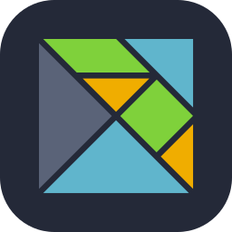
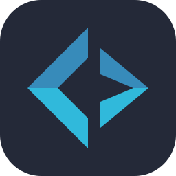

# Hei, jeg er Kenneth 👋

### Programvareutvikler · Fullstack med hovedtyngde i frontend

Nysgjerrig og løsningsorientert utvikler med erfaring fra forsikring, offentlig sektor og bygg og anlegg.
Det beste jeg vet er å lage løsninger som mange mennesker bruker hver dag.

---

<picture>
  <source media="(prefers-color-scheme: dark)" srcset="https://raw.githubusercontent.com/KennethOpheimshaug/KennethOpheimshaug/output/github-snake-dark.svg" />
  
</picture>

---

## 🛠️ Tech stack

**Språk**

  
  
  

**Frontend**

  

  
  
  
  

**Backend**

  

  
  
  
  
  

**Databaser, sky og drift**

  

  
  
  
  

**Testing**

  

  
  

**KI og data**

  
  
  
  
  

**Verktøy**

  

  
  

---

## 📊 GitHub-statistikk

  
<picture>
  <source media="(prefers-color-scheme: dark)" srcset="https://raw.githubusercontent.com/KennethOpheimshaug/KennethOpheimshaug/output/profile-summary-card-output/github_dark/2-most-commit-language.svg" />
  
</picture>
<picture>
  <source media="(prefers-color-scheme: dark)" srcset="https://raw.githubusercontent.com/KennethOpheimshaug/KennethOpheimshaug/output/profile-summary-card-output/github_dark/1-repos-per-language.svg" />
  
</picture>

---

## 🎓 Utdanning og sertifiseringer

- **Bachelor i informasjonsvitenskap** – Universitetet i Bergen (2017–2019)
- **Bachelor i eiendomsmegling** – BI (2008–2011)
- **Microsoft Exam 480** – Programming in HTML5 with JavaScript and CSS3 (2020)
- Kurs: *The Joy of React* (2024) · *React – The Complete Guide* (2020)

---

**Ta gjerne kontakt – jeg er alltid åpen for en prat om spennende prosjekter.**

