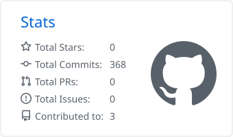
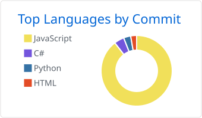
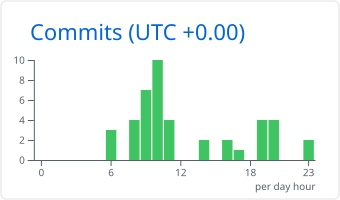
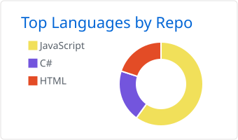

# Hei, jeg er Kenneth 👋

### Programvareutvikler · Fullstack med hovedtyngde i frontend

Nysgjerrig og løsningsorientert utvikler med erfaring fra forsikring, offentlig sektor og bygg og anlegg.
Det beste jeg vet er å lage løsninger som mange mennesker bruker hver dag.

---

## 🧑‍💻 Om meg

- 💼 **Programvareutvikler siden 2019** – fra Experis Academy via Frende Forsikring til Rainfall / Solea
- 🏗️ **Arkitekt og utvikler** på selvbetjeningsportaler for Bergen kommune og Allier Gruppen
- 🎨 Bred fullstack-erfaring, med **frontend og universell utforming** som spesialfelt
- 🧪 Trives med **testdrevet og brukerstyrt utvikling** i smidige, tverrfaglige team
- 🎓 Bachelor i **informasjonsvitenskap** (UiB) og **eiendomsmegling** (BI)
- 🌱 Liker å lære – og like mye å dele det jeg kan med teamet

---

## 🛠️ Tech stack

**Språk og rammeverk**

  

  
  

**Databaser og sky**

  

  
  

**Verktøy og drift**

  

  
  
  
  

**Metodikk**
`Universell utforming` · `Testdrevet utvikling` · `Brukerstyrt utvikling` · `Systemutvikling` · `Smidig / Kanban` · `KI-assistert utvikling`

---

## 📈 Commit-kart

<picture>
  <source media="(prefers-color-scheme: dark)" srcset="https://raw.githubusercontent.com/KennethOpheimshaug/KennethOpheimshaug/output/github-snake-dark.svg" />
  
</picture>

---

## 📊 GitHub-statistikk

<picture>
  <source media="(prefers-color-scheme: dark)" srcset="./profile-summary-card-output/github_dark/3-stats.svg" />
  
</picture>
<picture>
  <source media="(prefers-color-scheme: dark)" srcset="./profile-summary-card-output/github_dark/2-most-commit-language.svg" />
  
</picture>
<picture>
  <source media="(prefers-color-scheme: dark)" srcset="./profile-summary-card-output/github_dark/4-productive-time.svg" />
  
</picture>
<picture>
  <source media="(prefers-color-scheme: dark)" srcset="./profile-summary-card-output/github_dark/1-repos-per-language.svg" />
  
</picture>

---

## 💼 Erfaring

| Periode | Rolle | Arbeidsgiver |
|---|---|---|
| 2024 – 2026 | Programvareutvikler | **Rainfall AS / Solea AS** |
| 2021 – 2023 | Programvareutvikler | **Frende Forsikring AS** |
| 2019 – 2021 | Fullstack-utvikler | **Experis AS** (Experis Academy, konsulent i Frende) |

### 🚀 Utvalgte oppdrag

| Kunde | Prosjekt | Rolle |
|---|---|---|
| **Bergen kommune** | Selvbetjeningsportal – Boei | Arkitekt og utvikler |
| **Framo AS** | Videreutvikling av integrasjon mot databasesystem | Utvikler |
| **Allier Gruppen AS** | Selvbetjeningsportal | Arkitekt og utvikler |
| **Dynamon AS** | Fraværspredikator | Utvikler |
| **Frende Forsikring** | Meld skade – personskade, utett bygg, reisegods og eneuhell bil | Frontend-/fullstack-utvikler, opplæringsansvarlig |

---

## 🎓 Utdanning og sertifiseringer

- **Bachelor i informasjonsvitenskap** – Universitetet i Bergen (2017–2019)
- **Bachelor i eiendomsmegling** – BI (2008–2011)
- **Microsoft Exam 480** – Programming in HTML5 with JavaScript and CSS3 (2020)
- Kurs: *The Joy of React* (2024) · *React – The Complete Guide* (2020)

---

**Ta gjerne kontakt – jeg er alltid åpen for en prat om spennende prosjekter.**

